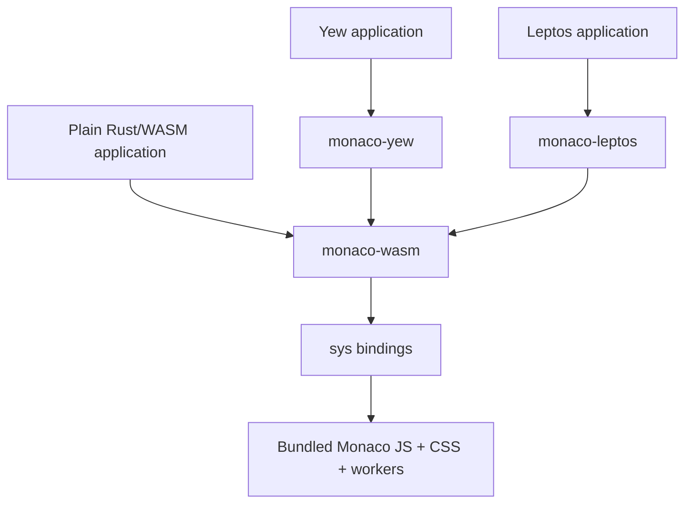

# Monaco for Rust/WASM, Yew, and Leptos

Status: implementation proposal, reviewed 2026-10-21. API examples below specify the intended interface; the crates and build commands do not exist yet. Source-backed facts are linked; packaging and generator feasibility still require the first implementation milestone.

## 1. Deliverable and definition of done

Deliver a reusable Rust library that runs Monaco in a browser, plus Yew and Leptos component crates. A consumer adds a Cargo dependency and uses the API/component through their normal Rust web build. The default path requires **no npm install, JavaScript bootstrap, CDN, manual worker configuration, or asset copying by the consumer**.

Monaco remains JavaScript hosted by the browser. “Pure WASM layer” means Rust bindings and resource management independent of any UI framework, compiled for `wasm32-unknown-unknown`. The distributed web application necessarily includes JavaScript glue and Monaco assets.

The first release is done when three fresh consumer projects—plain Rust/WASM, Yew, and Leptos—build from packaged crate contents and display a working editor, including JSON diagnostics, without Node installed. All three use the same core implementation. Leptos is a planned deliverable, implemented after Yew.

Scope: single-document editing, basic configuration, change notifications, imperative access, deterministic cleanup, and an extension path. Do not implement controlled-value synchronization, shared models, diff editing, collaboration, custom language providers, or an IDE in v0.1.

## 2. Decisions from the review

| Decision | Concrete reason |
| --- | --- |
| Ship the Monaco runtime inside the core crate. | Requiring every application to bundle npm assets would fail the simple Cargo-consumer requirement. |
| Use three crates with one-way dependencies. | Non-framework applications must not pull in Yew or Leptos, and neither adapter should depend on the other. |
| Use standard Trunk examples and a `wasm-pack --target web` example. | They exercise actual Rust consumer paths; a second consumer asset build is unnecessary. |
| Keep one strong editor owner and cloneable weak handles. | A callback retaining a handle must not keep an unmounted editor alive. |
| Define document replacement, event timing, and failure behavior now. | Otherwise each adapter could overwrite user edits or dispose callbacks differently. |
| Evaluate generation against a fixed binding inventory with a bounded fallback. | Successful TypeScript parsing does not prove correct runtime imports or callback handling. |

The workspace currently contains this document and no application source. There are no existing callers to migrate. Implementation reaches the three crates, vendored runtime, maintainer tooling, examples, tests, CI, and release documentation.

## 3. Packages and compatibility

Names are working names; registry availability must be checked before publishing.

| Crate | Public responsibility | Dependencies |
| --- | --- | --- |
| `monaco-wasm` | Bundled runtime, low-level `sys` bindings, `Editor`, `EditorHandle`, options, events, errors | `wasm-bindgen`, `js-sys`, selected `web-sys` features; no framework |
| `monaco-yew` | `MonacoEditor` and Yew lifecycle/prop adaptation; re-export common core types | `monaco-wasm`, Yew 0.23 |
| `monaco-leptos` | `MonacoEditor` and Leptos reactive/lifecycle adaptation; re-export common core types | `monaco-wasm`, Leptos 0.8 |

Start with Monaco **0.57.0**, the stable release identified during research. Keep its npm version exact. Use Rust edition 2024; select and record an exact stable compiler in milestone 1, then establish the actual MSRV with CI rather than guessing it. Pin build/generation tooling and example lockfiles. The library manifests use compatible dependency ranges; the published support matrix records the exact tested resolutions. [Monaco release](https://github.com/microsoft/monaco-editor/releases/tag/v0.57.0)

The adapters depend on the same core release. Their framework dependencies use `default-features = false`; applications select rendering mode. Yew v0.1 supports CSR. Leptos exposes `csr`, `hydrate`, and `ssr` features forwarding to Leptos, with no default rendering mode. Server builds render an empty editor host and never execute browser APIs; hydration initializes Monaco only after the host is mounted. This is an SSR-compatible placeholder, not server-rendered editor content.



Do not split `sys` into a fourth crate yet. It has a public module for advanced use, while its generated implementation stays replaceable.

## 4. Consumer experience

These examples are the acceptance target for v0.1, not claims of already published packages.

Plain Rust/WASM:

```toml
[dependencies]
monaco-wasm = "0.1"
```

```rust
use monaco_wasm::{Editor, EditorConfig, EditorError};
use web_sys::HtmlElement;

fn mount_editor(host: &HtmlElement) -> Result<Editor, EditorError> {
    let mut config = EditorConfig::default();
    config.initial_value = "{\n  \"enabled\": true\n}".into();
    config.language = "json".into();
    Editor::new(host, config)
}
// Retain the returned Editor in application state. Dropping it disposes it.
// The application already needs web-sys to obtain/pass an HtmlElement.
```

Yew:

```toml
[dependencies]
yew = { version = "0.23", features = ["csr"] }
monaco-yew = "0.1"
```

```rust
use monaco_yew::MonacoEditor;
use yew::prelude::*;

#[function_component(App)]
fn app() -> Html {
    html! {
        <MonacoEditor language="json" initial_value="{}" />
    }
}
```

Leptos:

```toml
[dependencies]
leptos = { version = "0.8", features = ["csr"] }
monaco-leptos = { version = "0.1", features = ["csr"] }
```

```rust
use leptos::prelude::*;
use monaco_leptos::MonacoEditor;

#[component]
fn App() -> impl IntoView {
    view! {
        <MonacoEditor
            language=Signal::stored("json".to_owned())
            initial_value="{}"
        />
    }
}
```

The component container defaults to `height: 20rem; width: 100%; min-width: 0`; its inner editor host fills that space with `height: 100%; width: 100%`. Both adapters accept `class` and `style`; custom style is appended so callers can override the default dimensions. An unconfigured component must be visible. Raw `Editor::new` leaves sizing to the caller.

Each runnable example also includes Save, Replace document, read-only toggle, and mount/unmount controls. Save reads text through the handle; typing does not copy the entire document into framework state.

## 5. Runtime packaging: maintainer work, not consumer work

### Artifact contract

Check in and include these files in the published `monaco-wasm` package:

```text
js/runtime.js              standalone ESM, exports only the small bridge
js/runtime-manifest.json   Monaco version, build tool versions, input/output hashes
js/THIRD_PARTY_NOTICES      upstream notices for everything actually bundled
```

Use the supported local module mechanism:

```rust
#[wasm_bindgen(module = "/js/runtime.js")]
extern "C" {
    #[wasm_bindgen(catch, js_name = getEditorApi)]
    fn get_editor_api() -> Result<JsValue, JsValue>;
}
```

The path is relative to the library's crate root. `wasm-bindgen` carries the module into generated application output. Its documentation warns that local snippets must be standalone, so the build must emit **no unresolved imports, dynamic import URLs, or sibling asset dependencies**. Test both `web` and bundler output. [JS snippets](https://wasm-bindgen.github.io/wasm-bindgen/reference/js-snippets.html)

### Maintainer build

Use a small Node script and esbuild in `tools/runtime/`, with an exact `monaco-editor` dependency and npm lockfile. Node is required only to rebuild vendored assets.

1. Bundle the editor and required editing contributions. Include plaintext and JSON in the initial runtime. Include JSON tokenization and language service registration, not just its worker.
2. Bundle the core and JSON workers separately into self-contained classic-worker scripts. Resolve all worker dependencies at build time.
3. Collect editor CSS and embed it as text. Inline referenced fonts/images as data URLs; reject any unhandled asset URL. Preserve the assets' notices.
4. Embed worker sources as strings in the runtime. Create their Blob URLs lazily and install `MonacoEnvironment.getWorker` before editor creation.
5. Bundle Monaco without code splitting into a function body evaluated by `getEditorApi()` on first use. This is generated source wrapping, not runtime `eval` or `new Function`. It keeps initialization failures inside the caught call and avoids browser work merely from importing the module.
6. Cache the initialized API, one stylesheet, and at most one Blob URL per worker kind for the document lifetime. Let Monaco manage individual worker instances. A component must never terminate workers shared by other components.

`getEditorApi()` synchronously returns the `monaco.editor` API object after setup. There is one module instance per resolved core package, shared by both adapters. There is no public initialization prop and no required global `window.monaco` assignment. Do not overwrite an existing foreign `MonacoEnvironment`: fail with a setup error explaining the conflict. Supporting a pre-existing separately bundled Monaco runtime is deferred.

Use the 0.57 package export map to resolve the editor, contributions, and worker inputs. Record the exact successfully built import paths in the build script during milestone 1. The root entry registers all languages/features; do not claim a JSON-only runtime while using it indiscriminately. [Package exports](https://github.com/microsoft/monaco-editor/blob/v0.57.0/package.json), [root entry](https://github.com/microsoft/monaco-editor/blob/v0.57.0/src/index.ts)

### Deployment contract and limits

The consumer deploys the complete output directory from Trunk, wasm-pack/bundler, or cargo-leptos, including generated JS snippets. There are no additional runtime downloads or CDN requests. Verify deployment under `/demo/`, not only `/`.

The default distribution requires Blob workers (`worker-src blob:` under CSP), injected editor styles, data-URL font/image assets if emitted, and the application's normal WASM permissions. Document the tested production CSP after measuring the artifact. Strict policies forbidding these mechanisms need a future external-assets mode; do not silently disable workers. The bundle is loaded with the application's JS; lazy downloading and tree-shaking by the consumer are not promised.

The package gate must verify generated bundle size against registry limits and record raw/compressed JS, WASM, and total transfer size. If self-contained packaging fails, resolve it before building the adapters. Do not quietly substitute a consumer npm setup, since that changes the deliverable.

## 6. Core Rust API and semantics

The following is a signature sketch, with implementations omitted:

```rust
#[derive(Clone, Debug, PartialEq)]
#[non_exhaustive]
pub struct EditorConfig {
    pub initial_value: String, // default: empty
    pub language: String,      // default: "plaintext"
    pub options: EditorOptions,
}

#[derive(Clone, Debug, PartialEq)]
#[non_exhaustive]
pub struct EditorOptions {
    pub read_only: bool,       // false
    pub font_size: f64,        // 14.0; finite and > 0
    pub word_wrap: WordWrap,   // Off
    pub minimap_enabled: bool, // false
    pub line_numbers: LineNumbers, // On
    pub aria_label: String,    // "Code editor"; not blank
}

pub enum WordWrap { Off, On }
pub enum LineNumbers { Off, On }

#[derive(Clone, Copy, Debug, PartialEq)]
pub struct ContentChange {
    pub version_id: f64, // Monaco's JS number, not a truncated u32
    pub is_flush: bool,
}

#[derive(Clone, Debug)]
#[non_exhaustive]
pub enum EditorError {
    Disposed,
    UnsupportedTarget,
    InvalidOptions(String),
    JavaScript { operation: &'static str, cause: JsValue },
}

pub struct Editor { /* sole owner; not Clone */ }
#[derive(Clone)]
pub struct EditorHandle { /* weak reference to owner state */ }

impl Editor {
    pub fn new(host: &HtmlElement, config: EditorConfig) -> Result<Self, EditorError>;
    pub fn handle(&self) -> EditorHandle;
    pub fn set_on_change(&mut self, callback: impl Fn(ContentChange) + 'static);
    pub fn dispose(&mut self) -> Result<(), EditorError>;
}

impl EditorHandle {
    pub fn value(&self) -> Result<String, EditorError>;
    pub fn replace_document(&self, value: &str) -> Result<(), EditorError>;
    pub fn set_language(&self, language: &str) -> Result<(), EditorError>;
    pub fn update_options(&self, options: &EditorOptions) -> Result<(), EditorError>;
    pub fn focus(&self) -> Result<(), EditorError>;
    pub fn layout(&self) -> Result<(), EditorError>;
    pub fn raw_editor(&self) -> Result<sys::StandaloneCodeEditor, EditorError>;
}

pub fn set_theme(name: &str) -> Result<(), EditorError>;
```

Implement `Default` for configuration/options and ordinary derives for the two enums. Because the option structs are non-exhaustive, consumers construct `Default::default()` and then assign fields, as in the plain WASM example. This allows later fields without breaking downstream struct literals. No builder macro or serde dependency is needed.

All editor/browser operations are local to the browser thread. Do not add unsafe `Send`/`Sync` implementations. Keep configuration and event types usable on native builds; native calls into browser functionality return `UnsupportedTarget` without touching JS.

### Mapping and updates

| Rust setting/operation | Monaco call/property |
| --- | --- |
| Create | `createModel(initial_value, language)` then `create(host, { model, automaticLayout: true, ...options })` |
| Read / replace | `model.getValue()` / `model.setValue(value)` |
| Language | `editorApi.setModelLanguage(model, language)` |
| Read-only / font / wrap | `readOnly`, `fontSize`, `wordWrap: "off" or "on"` |
| Minimap / line numbers / label | `minimap: { enabled }`, `lineNumbers: "off" or "on"`, `ariaLabel` |
| Update | `editor.updateOptions(...)` with all six supported effective option values |
| Focus / layout | `editor.focus()` / `editor.layout()` |
| Theme | `editorApi.setTheme(name)`, shared by every editor in the bundle |

Validate all supplied configuration before the first mutation. Reject blank language IDs; nonblank IDs are passed through and only registered languages get language features. Use Monaco's automatically allocated URI by omitting the optional URI argument; do not build a parallel ID registry. Keep the owned model private; external/shared model ownership is out of scope. The public `sys` module permits low-level model creation for advanced users, with explicit disposal responsibility.

`update_options` is a complete replacement of the supported option subset, so returning a field to its default actively resets it. It does not reset unrelated options configured through raw access. Font sizes outside Monaco's effective range may be clamped by Monaco; the wrapper only validates finite positive input. [Construction options](https://microsoft.github.io/monaco-editor/typedoc/interfaces/editor_editor_api.editor.IStandaloneEditorConstructionOptions.html)

`replace_document` calls `setValue` on the same model. It resets undo history and does not promise cursor preservation. It emits Monaco's normal change notification, including `is_flush`; it is not a silent write or collaborative edit. No synthetic event is emitted if Monaco emits none. Reading the whole value is O(document length); notifications do not perform that read. [Model API](https://microsoft.github.io/monaco-editor/typedoc/interfaces/editor_editor_api.editor.ITextModel.html), [upstream undo discussion](https://github.com/microsoft/monaco-editor/issues/299)

`set_theme` applies globally and initializes the runtime if necessary. Component creation must not reset the chosen theme. Accept built-in or already registered names. Expose `sys::editor_api() -> Result<sys::EditorApi, JsValue>` for advanced callers, with no ownership attached. Custom theme registration can use additional extern bindings on that object until a caller needs a safe wrapper.

Raw JS objects are mutable capabilities, not read-only views. Callers must not dispose, replace the model, or retain and use a raw editor after owner disposal. Raw operations bypass the handle's liveness checks. The next prop update takes precedence over raw changes to component-managed settings.

### Ownership, events, and errors

`Editor` owns an `Rc` state containing editor/model handles and the event subscription. `EditorHandle` stores `Weak`; its equality is owner identity. A disposed flag is checked even while temporary strong references exist. Handles retained by applications do not keep editor resources alive.

Use one content listener per editor, installed before reporting readiness. `set_on_change` replaces the Rust callback without re-registering the Monaco subscription. The default callback does nothing.

Deliver changes asynchronously in FIFO order using a microtask queue in the small JS bridge. Each queued event contains only version and flush state. Dispatch checks an active flag and reads the current callback. Thus `on_change` can read or replace text, trigger a rerender, or unmount the component without running inside Monaco's original mutation stack. Events queued before disposal are discarded. A value read during a callback is the latest value, not a historical snapshot of that event's version. Versions are ordered identifiers, not guaranteed consecutive numbers.

Never hold a Rust `RefCell` borrow across a JS call or application callback. Clone the JS handle or Rust callback under a short borrow and release it first. A replacement made from a change callback queues a later event; it must not recursively invoke a borrowed `FnMut` closure.

Disposal order is fixed:

1. Mark the state disposed and deactivate the event relay, clearing its reference to the Rust callback.
2. Unsubscribe the Monaco listener, dispose the editor, then dispose its model. Attempt every step even if a previous step throws; return the first error with its operation name.
3. Release Rust closures after any currently executing relay call returns. If cleanup occurs from inside a callback, defer that release to the next microtask. A relay detached in step 1 must not call a dropped closure even if unsubscribe throws.

`dispose` is idempotent. `Drop` invokes the same cleanup; it never panics and logs an unexpected cleanup error to the console because it cannot return one. Explicit adapter cleanup reports the error before dropping state. Failure after model creation but before complete editor/subscription creation cleans up every successfully created resource.

All imported operations that can throw use `#[wasm_bindgen(catch)]`, preserving the original `JsValue`. A worker failure occurring later is a browser error, not a synchronous `Editor::new` result; browser tests must catch it. Do not promise that `on_ready` means all language workers have completed initialization. [Exception imports](https://wasm-bindgen.github.io/wasm-bindgen/reference/attributes/on-js-imports/catch.html)

## 7. Framework adapters

Both adapters render an outer container, an empty inner Monaco host, and an optional sibling error message. The framework never renders children inside the Monaco host. A setup failure leaves the host empty and displays “Editor could not be initialized” with `role="alert"`; report details through `on_error`, or the console if no handler exists.

| Prop | Yew type | Leptos type | Contract |
| --- | --- | --- | --- |
| `initial_value` | `AttrValue` | `String` with `into` | Empty by default; read once on mount. |
| `language` | `AttrValue` | `Signal<String>` with `into` | Defaults to plaintext; updates existing model. |
| `options` | `EditorOptions` | `Signal<EditorOptions>` with `into` | Defaults as above; updates existing editor. |
| `class`, `style` | `Classes`, `AttrValue` | `Signal<String>` with `into` | Defaults empty; style overrides default container dimensions. |
| `on_ready` | `Option<Callback<EditorHandle>>` | `Option<UnsyncCallback<EditorHandle>>` | Called once after editor and subscription creation. |
| `on_change` | `Option<Callback<ContentChange>>` | `Option<UnsyncCallback<ContentChange>>` | Core event contract. |
| `on_error` | `Option<Callback<EditorError>>` | `Option<UnsyncCallback<EditorError>>` | Setup or adapter-applied update/cleanup failure. Imperative calls return their errors directly. |

There is no required runtime/provider prop. Neither adapter writes a `value` back on each render. Switching documents means explicitly calling `replace_document` or remounting the component. In Yew use a changed `key`; in Leptos use a keyed view or conditional remount. Changing `initial_value` alone intentionally does nothing.

### Yew

Use a struct component with `NodeRef`, `Option<Editor>`, and the last successfully applied language/options. `rendered(first_render)` creates the editor. `changed` updates language/options without recreating it and rerenders container attributes as needed. The core callback sends a component message; message handling uses the newest callback prop and returns false unless visible UI changed. Check that the editor is still live before delivering a queued message. `destroy` disposes the owner. [Yew lifecycle](https://yew.rs/docs/advanced-topics/struct-components/lifecycle)

Replacing `on_ready` after mounting does not fire it again. Replacing `on_change` affects the next delivered notification. Validate a proposed option/language update before applying either. If a JS update fails, keep the editor and text alive, report the error, and do not mark the failed field as applied. A subsequent relevant prop update retries it; do not retry in a render loop. Successful fields remain applied; there is no transaction or rollback across Monaco calls. A setup failure requires a remount to retry.

### Leptos

Use `NodeRef<html::Div>` and a client effect that waits for that reference to create one editor after the host exists. Read options/language untracked in the creation effect so they cannot trigger recreation. Store the non-`Send` owner in `StoredValue::new_local`; register component-owner cleanup that takes and disposes it. Use a separate effect for `language` and `options`, comparing the last successful values. Read the latest signals when mounting so updates before mount are not lost.

Callbacks use `UnsyncCallback` so browser handles need no `Send`/`Sync` workaround. Invoke callbacks outside storage borrows and use `try_run` during cleanup if the reactive owner may already be disposing. Apply the same failure/retry rules as Yew. [NodeRef](https://docs.rs/leptos/latest/leptos/prelude/struct.NodeRef.html), [local storage](https://docs.rs/leptos/latest/leptos/prelude/struct.StoredValue.html), [callbacks](https://docs.rs/leptos/latest/leptos/callback/index.html), [cleanup](https://docs.rs/leptos/latest/leptos/prelude/fn.on_cleanup.html)

For SSR, render the identical empty host structure on server and initial client hydration. Gate browser code with `cfg(target_arch = "wasm32")`; create Monaco in a client effect after hydration has claimed the host. The initial text is supplied on the client and is not rendered as HTML. Include one cargo-leptos hydration fixture; it must build server code without evaluating JS and hydrate without mismatch warnings. [Leptos JS integration](https://book.leptos.dev/web_sys.html)

## 8. Low-level bindings and generator decision

Monaco's public declarations are the binding source of truth. Do not bind private editor implementation modules. `wasm-bindgen` provides the ABI, but importing arbitrary TypeScript requires another generator. [Monaco API policy](https://github.com/microsoft/monaco-editor)

Initial binding inventory:

| Receiver/type | Members needed by the safe API |
| --- | --- |
| Bundled module | `getEditorApi`, detachable queued event relay |
| Editor API object | `create`, `createModel`, `setModelLanguage`, `setTheme` |
| Standalone editor | `updateOptions`, `focus`, `layout`, `dispose` |
| Text model | `getValue`, `setValue`, `onDidChangeContent`, `dispose` |
| Disposable | `dispose` |
| Content event | `versionId`, `isFlush` |
| Dictionaries | construction options, six supported update options, nested minimap |

Bind object members as structural methods; no constructor/global namespace lookup is necessary. For example, `getEditorApi()` returns the receiver for `createModel`. Handle correct `this` binding, JS exceptions, strings, numbers, and `undefined` for the omitted model URI. The rest of the Monaco API need not be generated or compiled initially. [Structural imports](https://wasm-bindgen.github.io/wasm-bindgen/reference/attributes/on-js-imports/structural.html)

Evaluate `wasm-bindgen/ts-gen` first. It generates extern bindings and supports namespaces/interfaces but documents partial generic support. Its suitability for Monaco is unproven. Compare `rust-monaco`'s `ts2rs` only if the first attempt fails in a way it already solves; `ts-bindgen` is a secondary candidate with a larger runtime. [ts-gen](https://github.com/wasm-bindgen/ts-gen), [rust-monaco](https://github.com/siku2/rust-monaco), [ts-bindgen](https://github.com/ratchetdesigns/ts-bindgen)

Bound the investigation to one development day:

1. Pin a generator release/commit. Use declarations resolved from the exact installed npm package; record paths and hashes.
2. Try upstream declarations for the inventory above. Check namespaces, inheritance, optional/nested dictionaries, unions, overloads, event callable types, DOM types, structural linkage, and caught exceptions.
3. If full declarations pull in unsupported types, try one small typed facade projecting the required surface. Type-check that facade against upstream types; do not write a generic subset extractor.
4. Accept only if output compiles for WASM and passes create/read/change/update/dispose in a browser, including callback lifetime tests. Record the command, output, and remaining manual bindings in `tools/bindings/DECISION.md`.
5. If that gate fails, write the small inventory by hand using wasm-bindgen externs. Keep the public API and packaging identical. Do not delay the usable crate to build a TypeScript compiler.

TypeScript does not describe Rust ownership or exception policy; those remain handwritten even with generation. Put generated files under `sys/generated.rs` and adaptations under `sys/manual.rs`. Generated imports must honor the runtime contract and `catch` requirements, not import an npm package in consumer output.

When generation is adopted, check in output, input metadata, and any reproducible transforms. `npm run bindings:check` regenerates into a temporary directory and fails on differences. There is no generation or npm execution in `build.rs`. If handwritten bindings are chosen, record that decision and run the inventory/facade and browser checks instead; do not provide a misleading no-op generation check.

## 9. Extension example: tab size

Adding `tab_size` should touch only these places:

1. Add `tab_size: u32` with default 4 to `EditorOptions`, validating a nonzero value.
2. Add the `ITextModel.updateOptions` binding and `tabSize` dictionary member.
3. Apply `model.updateOptions({ tabSize })` at creation and on change. Keep model and editor settings distinct internally even though the public configuration is small.
4. Add a browser assertion that changes 4 to 2 and back to 4 without replacing text or the model.
5. Document the option. Both adapters already pass `EditorOptions` through, so no new prop or framework implementation should be necessary.

Use this as an acceptance exercise after the base API works. Retain the additional option only if wanted for the release; it is not a reason to build a general settings schema. More complex APIs start in the core crate, with framework props added only when their use is genuinely declarative.

## 10. Implementation files and milestones

```text
Cargo.toml, Cargo.lock, rust-toolchain.toml
crates/monaco-wasm/
  Cargo.toml
  src/{lib,editor,options,error}.rs
  src/sys/{mod,generated,manual}.rs
  js/{runtime.js,runtime-manifest.json,THIRD_PARTY_NOTICES}
crates/monaco-yew/{Cargo.toml,src/lib.rs}
crates/monaco-leptos/{Cargo.toml,src/lib.rs}
tools/runtime/{package.json,package-lock.json,build.mjs,src/}
tools/bindings/{DECISION.md,manifest.json,fixtures/}
examples/wasm-basic/                wasm-pack web target, static index.html
examples/yew-basic/                 Trunk, only Cargo dependencies
examples/leptos-basic/              Trunk CSR, only Cargo dependencies
examples/leptos-hydrate/            cargo-leptos SSR/hydration fixture
browser-tests/                     Playwright harness, dev dependency only
.github/workflows/ci.yml
```

Do not create empty modules before they have code. The file list allocates responsibility; small implementations can stay in `lib.rs` until separation helps.

| Milestone | Concrete result | Exit gate |
| --- | --- | --- |
| 1. Package proof | Vendored standalone runtime, minimum extern bindings, plain WASM example, generator decision | Build from an extracted crate archive with no Node; text editing and JSON diagnostics work under `/demo/`; no missing snippets, fonts, styles, or workers. |
| 2. Core API | Owner/weak handle API, validation, event relay, errors, disposal | Reentrant callback and disposal tests pass; 100 mount/dispose cycles return model/subscription counts to baseline. |
| 3. Yew | Component, props, callbacks, Trunk example | Text survives parent rerenders; all supported options update; callbacks and retained handles behave as specified. |
| 4. Leptos | Component, CSR example, SSR/hydration fixture | Signal updates do not recreate the editor; client cleanup works; server render and hydration are clean. |
| 5. Release | Packaged-consumer tests, docs, notices, compatibility table, extension exercise | All three consumer paths work from package contents without Node; runtime regeneration is reproducible; archive size is publishable. |

Consumer commands to make real as their corresponding milestones complete:

```sh
cargo check -p monaco-wasm --target wasm32-unknown-unknown --locked
wasm-pack build examples/wasm-basic --target web --out-dir pkg
trunk build examples/yew-basic/index.html --release --public-url /demo/
trunk build examples/leptos-basic/index.html --release --public-url /demo/
cargo package -p monaco-wasm --list
```

The examples keep editor owners alive in app state and shut them down explicitly when unmounted. The plain example may export a small mounted-app owner to JavaScript for the static test page; this is example code, not a consumer bootstrap requirement imposed by the library.

Maintainer scripts to implement: `runtime:build`, `runtime:check`, and, if adopted, `bindings:generate` / `bindings:check`. Record exact tool versions in the first milestone. Do not give an overall delivery estimate until self-contained packaging and generation have been exercised.

## 11. Required tests and release gates

Use a real browser. Run a common browser behavior suite against the plain, Yew, and Leptos demos where applicable. Playwright and Node belong to the test environment, not the consumer build environment.

| Test | Required assertion |
| --- | --- |
| Minimal usage | Editor is visible with default component dimensions; typing and Save return the expected text. |
| Text ownership | Type text, rerender parent/change signal, and change `initial_value`; existing text and model identity stay unchanged. |
| Configuration | Every option changes and resets to default; invalid values report errors before mutation. |
| Replacement | Same model, new text, cleared undo history, normal flush notification; no duplicate synthetic event. |
| Reentrant callback | `on_change` can read text, replace once, or unmount without a borrow panic or recursive closure invocation. |
| Callback lifetime | Swapping Yew callback uses the new callback; events queued before disposal are dropped. |
| Cleanup | 100 mounts/disposals leave `getModels().length` and active relay counts at baseline; retained safe handles return `Disposed`. |
| Partial failure | Inject failure at editor/subscription creation and at unsubscribe; completed resources are cleaned up and no dead Rust callback remains reachable. |
| Isolation | Two editors retain independent text; dispose one and continue typing in the other; theme intentionally affects both. |
| Workers | Invalid JSON produces diagnostics through the JSON worker; worker errors and console fallback warnings fail the test. |
| Assets | Production output under `/demo/` loads JS snippets, WASM, CSS, fonts, and workers without external requests. |
| Native/SSR | Native compile succeeds; server markup contains an empty host; hydration produces one editor and no mismatch warning. |
| Packaging | Repeat smoke builds against extracted `.crate` archives outside this workspace with Node/npm unavailable. |

For the packaging test, build archives of all three crates, extract them into a temporary consumer tree, and use local registry/path overrides pointing only to those extracted contents. Remove access to workspace source and `node_modules`. The build container contains Rust and the supported Rust web build tools; a separate browser-test container may contain Node. Inspect the archive for the runtime and notices. This catches missing `Cargo.toml include` entries that workspace tests cannot detect.

CI also runs formatting, WASM checks/clippy, native SSR checks, artifact reproducibility, and library packaging. Start browser execution with Chromium; run Firefox and WebKit smoke tests before declaring support for those browsers. Measure bundle sizes and model/event counts; do not claim absence of all memory leaks based solely on model count.

## 12. Research conclusions and remaining uncertainty

The existing `siku2/rust-monaco` crate already has raw/safe/Yew layers and embedded worker support. Its documented crate version is 0.7.0 and current main declares Yew 0.23; its precise Monaco pin was not verified here. Use it as a reference and assess reusable code under its license, but do not make a stale-version assumption the basis for the new architecture. [Crate](https://docs.rs/monaco/latest/monaco/), [manifest](https://github.com/siku2/rust-monaco/blob/main/Cargo.toml)

Monaco has changed AMD loading, language namespace locations, and ESM exports in recent releases. Pin the runtime and declarations together, review the changelog on upgrades, regenerate/rebuild artifacts, and rerun packaged-consumer tests before expanding the compatibility claim. [Changelog](https://github.com/microsoft/monaco-editor/blob/main/CHANGELOG.md)

The architectural choices are settled for implementation: three crates, bundled default runtime, owner/weak handles, uncontrolled text, shared options, and framework-specific lifecycle adapters. The bounded implementation investigations are exact bundler entry paths and artifact size, generator success, tested compiler/tool versions, and final crate-name availability.

No crate, generator output, or browser prototype was built during this design review. The main unresolved feasibility risk is packaging the selected Monaco runtime and workers into a self-contained crate artifact; milestone 1 must prove it before adapter work begins. The default Blob-worker/CSP tradeoff is deliberate and must appear in the eventual README.
